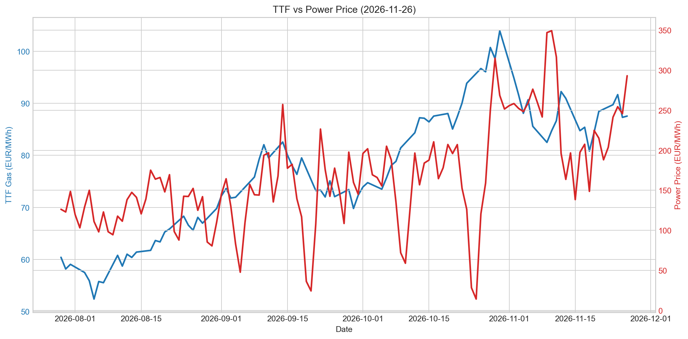

# European Energy Market Risk Analysis

## Project Overview

A Python-based quantitative analytics project monitoring the relationship between European natural gas, carbon and electricity prices.

The project combines market data collection, data processing, quantitative modelling and automated reporting to produce an energy market risk pack.

## Key Features

- **Market Data Collection:** Retrieves electricity prices from the Energy-Charts API and gas and carbon-linked price data from Yahoo Finance.
- **Data Processing:** Cleans, aligns and merges market datasets.
- **Quantitative Analysis:** Calculates clean spark spreads, implied power generation costs, price changes, rolling correlations and gas-to-power beta.
- **Data Visualisation:** Generates market charts using Matplotlib.
- **Automated Reporting:** Produces daily market commentary and structured JSON metrics.
- **AI Integration:** Optional OpenAI API integration for market commentary.

## Technologies

- Python
- Pandas
- Matplotlib
- Requests
- yfinance
- OpenAI API (optional)

## Project Structure

```text
energy-market-risk-analysis/
│
├── Main Code.py
├── Report.md
├── README.md
│
└── outputs/
    ├── raw/
    ├── clean/
    ├── charts/
    ├── briefs/
    ├── logs/
    └── manifest.json
```

## Analytical Framework

| Metric | Description |
|---|---|
| TTF Price | European natural gas price |
| Power Price | German electricity price |
| Carbon Price | Carbon-linked price proxy |
| Implied Power Price | Estimated gas-fired generation cost |
| Clean Spark Spread | Electricity price less implied generation cost |
| Rolling Correlation | 20-day TTF and power price correlation |
| Gas-to-Power Beta | 20-day sensitivity of power price changes to gas price changes |

## Quantitative Methodology

The analytical framework combines European natural gas, electricity and carbon price data to estimate gas-fired power generation economics and monitor cross-commodity market relationships.

### 1. Implied Gas-Fired Generation Cost

The model estimates the marginal cost of gas-fired electricity generation by combining fuel costs, carbon costs and variable operating costs.

**Formula:**

\[
C_{\text{power}} =
\frac{P_{\text{TTF}}}{\eta}
+(P_{\text{CO2}}\times EF)+VOM
\]

Where:

- \(P_{\text{TTF}}\): Natural gas price (EUR/MWh)
- \(\eta\): Assumed gas generation efficiency (50%)
- \(P_{\text{CO2}}\): Carbon-linked price proxy (EUR/t)
- \(EF\): Emissions factor (0.37)
- \(VOM\): Variable operating and maintenance costs (EUR/MWh), assumed at EUR 2

### 2. Clean Spark Spread

The clean spark spread measures the difference between the electricity market price and the estimated marginal cost of gas-fired generation.

**Formula:**

\[
CSS=P_{\text{power}}-C_{\text{power}}
\]

Interpretation:

- Positive spread: Electricity prices exceed estimated generation costs.
- Negative spread: Estimated generation costs exceed electricity prices.
- Near-zero spread: Electricity prices are close to estimated generation costs.

The metric provides an indication of the economics of gas-fired power generation.

### 3. Rolling TTF–Power Correlation

The model calculates a rolling 20-observation Pearson correlation between TTF natural gas and electricity price levels.

\[
\rho_{20}=\operatorname{Corr}(TTF_t,Power_t)
\]

This indicator measures the strength and direction of the relationship between gas and electricity prices over time.

A higher positive correlation indicates a stronger historical relationship between the two price series over the observation window.

### 4. Gas-to-Power Beta

The model estimates a rolling 20-observation beta using daily price differences.

\[
\beta_{20}=
\frac{\operatorname{Cov}(\Delta Power,\Delta TTF)}
{\operatorname{Var}(\Delta TTF)}
\]

This measures the historical sensitivity of electricity price changes to changes in natural gas prices.

A positive beta indicates that electricity prices have historically tended to move in the same direction as gas prices. The magnitude indicates the estimated price sensitivity.

### 5. Market Performance Indicators

The model also calculates:

- Daily percentage price changes.
- Five-observation percentage changes (used as a week-on-week proxy).
- Rolling 20-observation gas-to-power correlation.
- Rolling 20-observation gas-to-power beta.
- Carbon cost contribution to estimated generation costs.

### 6. Data Processing

Market datasets are collected from:

- Energy-Charts API: German electricity prices (DE-LU).
- Yahoo Finance: TTF natural gas and carbon-linked price proxies.

The datasets are merged into a daily panel, sorted chronologically and interpolated to align observations across different market calendars.

The resulting dataset feeds the quantitative calculations, visualisations and automated market commentary.

### 7. Model Assumptions and Limitations

The model uses fixed assumptions for gas generation efficiency, emissions intensity and variable operating costs. Actual plant economics vary according to technology, operating conditions and efficiency.

The carbon series uses a Yahoo Finance carbon-linked proxy rather than a direct representation of the European Union Allowance market.

Rolling correlations and beta are historical statistical measures and should not be interpreted as causal relationships or reliable forecasts.

The five-observation percentage change is an approximation of weekly performance rather than a strict calendar-week calculation.

Interpolated observations may affect calculated relationships, particularly around missing market data.

The implied generation cost and clean spark spread are simplified analytical estimates rather than a complete plant-level dispatch or profitability model.

## Project Outputs

### TTF Gas vs Electricity Prices



### Clean Spark Spread


### Market Data

- [Clean market dataset](outputs/clean/market_data_clean.csv)
- [Quantitative metrics snapshot](outputs/clean/metrics_snapshot.json)
- [Daily market brief](outputs/briefs/daily_brief.txt)
- [Detailed project report](Report.md)

## Installation and Usage

Install the required packages:

```bash
pip install pandas matplotlib requests yfinance
```

For optional AI-generated commentary:

```bash
pip install openai
```

Run the analysis:

```bash
python "Main Code.py"
```

To enable OpenAI commentary:

```bash
export OPENAI_API_KEY="your-api-key"
python "Main Code.py" --use-openai
```

## Data Sources

- Energy-Charts API
- Yahoo Finance

## Methodology and Assumptions

The model estimates gas-fired generation costs using gas efficiency, carbon emissions intensity and variable operating costs.

The carbon price series uses a Yahoo Finance carbon-linked market proxy. It should not be interpreted as a direct representation of all European carbon allowance markets.

## Disclaimer

This project is for educational and analytical purposes only. Data availability, source methodologies and modelling assumptions may affect results. It does not constitute investment advice.
