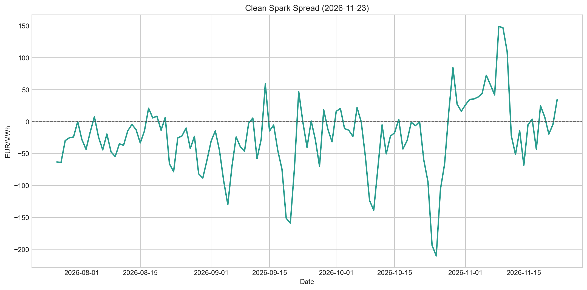

# European Energy Market Risk Analysis

## 1. Project Overview

A Python-based quantitative analytics project monitoring the relationship between European natural gas, carbon and electricity prices.

The project combines market data collection, data processing, quantitative modelling and automated reporting to produce an energy market risk analysis pack.

It focuses on estimating gas-fired electricity generation costs, monitoring clean spark spreads and analysing relationships between key European energy market variables.

## 2. Key Features

- **Market Data Collection:** Retrieves electricity prices from the Energy-Charts API and natural gas and carbon-linked price data from Yahoo Finance.
- **Data Processing:** Cleans, aligns and merges market datasets into a consolidated daily dataset.
- **Quantitative Analysis:** Calculates implied power generation costs, clean spark spreads, percentage price changes, rolling correlations and gas-to-power beta.
- **Data Visualisation:** Generates market charts using Matplotlib.
- **Automated Reporting:** Produces daily market commentary and structured JSON metrics.
- **AI Integration:** Supports optional OpenAI API integration for automated market commentary.

## 3. Technologies

- Python 3
- Pandas
- Matplotlib
- Requests
- yfinance
- OpenAI API (optional)

## 4. Project Structure

```text
energy-market-risk-analysis/
│
├── Main Code.py
├── Report.md
├── README.md
├── requirements.txt
├── .gitignore
│
└── outputs/
    ├── raw/
    ├── clean/
    ├── charts/
    ├── briefs/
    ├── logs/
    └── manifest.json
```

## 5. Analytical Framework

The project monitors the following quantitative indicators:

| Metric | Description |
|---|---|
| TTF Price | European natural gas price |
| Power Price | German electricity price |
| Carbon Price | Carbon-linked market price proxy |
| Implied Power Cost | Estimated marginal cost of gas-fired electricity generation |
| Clean Spark Spread | Electricity price less estimated generation cost |
| Rolling Correlation | 20-observation correlation between TTF and power price levels |
| Gas-to-Power Beta | 20-observation sensitivity of power price changes to gas price changes |
| Carbon Cost Component | Estimated carbon cost contribution to generation costs |

## 6. Quantitative Methodology

The model combines natural gas, electricity and carbon-linked price data to estimate gas-fired generation economics and monitor cross-commodity market relationships.

### 6.1 Implied Gas-Fired Generation Cost

The model estimates the marginal cost of gas-fired electricity generation by combining fuel costs, carbon costs and variable operating costs.

**Formula:**

\[
C_{\text{power}} =
\frac{P_{\text{TTF}}}{\eta}
+(P_{\text{CO2}}\times EF)+VOM
\]

Where:

- \(P_{\text{TTF}}\): Natural gas price.
- \(\eta\): Assumed gas generation efficiency (50%).
- \(P_{\text{CO2}}\): Carbon-linked price proxy.
- \(EF\): Emissions factor (0.37).
- \(VOM\): Variable operating and maintenance costs (EUR 2/MWh).

### 6.2 Clean Spark Spread

The clean spark spread measures the difference between the electricity market price and the estimated marginal cost of gas-fired generation.

**Formula:**

\[
CSS=P_{\text{power}}-C_{\text{power}}
\]

Interpretation:

- **Positive spread:** Electricity prices exceed estimated generation costs.
- **Negative spread:** Estimated generation costs exceed electricity prices.
- **Near-zero spread:** Electricity prices are close to estimated generation costs.

The indicator provides an estimate of the economics of gas-fired power generation.

### 6.3 Rolling TTF–Power Correlation

The model calculates a rolling 20-observation Pearson correlation between TTF natural gas and electricity price levels.

\[
\rho_{20}=\operatorname{Corr}(TTF_t,Power_t)
\]

A higher positive correlation indicates a stronger historical relationship between the two price series over the observation window.

### 6.4 Gas-to-Power Beta

The model estimates a rolling 20-observation beta using daily price differences.

\[
\beta_{20}=
\frac{\operatorname{Cov}(\Delta Power,\Delta TTF)}
{\operatorname{Var}(\Delta TTF)}
\]

This measures the historical sensitivity of electricity price changes to changes in natural gas prices.

A positive beta indicates that electricity prices have historically tended to move in the same direction as gas prices. The magnitude indicates the estimated price sensitivity.

### 6.5 Additional Market Indicators

The model also calculates:

- Daily percentage price changes.
- Five-observation percentage changes, used as a week-on-week proxy.
- Rolling 20-observation gas-to-power correlation.
- Rolling 20-observation gas-to-power beta.
- Carbon cost contribution to estimated generation costs.

### 6.6 Data Collection and Processing

Market data is collected from the following sources:

- **Energy-Charts API:** German electricity prices (DE-LU).
- **Yahoo Finance:** TTF natural gas and carbon-linked price proxies.

The datasets are merged into a daily panel, sorted chronologically and interpolated to align observations across different market calendars.

The processed dataset is used for quantitative calculations, visualisations and automated market commentary.

## 7. Model Assumptions and Limitations

The model uses fixed assumptions for gas generation efficiency, emissions intensity and variable operating costs. Actual plant economics vary according to technology, operating conditions and efficiency.

The carbon series uses a Yahoo Finance carbon-linked proxy rather than a direct representation of the European Union Allowance market.

Rolling correlations and beta are historical statistical measures and should not be interpreted as causal relationships or reliable forecasts.

The five-observation percentage change is an approximation of weekly performance rather than a strict calendar-week calculation.

Interpolated observations may affect calculated relationships, particularly around missing market data.

The implied generation cost and clean spark spread are simplified analytical estimates rather than a complete plant-level dispatch or profitability model.

## 8. Project Outputs

The project generates updated market datasets, visualisations and automated reporting outputs.

### TTF Gas vs Electricity Prices


### Clean Spark Spread



### Market Data and Reports

- [Clean market dataset](outputs/clean/market_data_clean.csv)
- [Quantitative metrics snapshot](outputs/clean/metrics_snapshot.json)
- [Daily market brief](outputs/briefs/daily_brief.txt)
- [Detailed project report](Report.md)

## 9. How to Run This Project

The project can be downloaded and executed locally using Python 3.

### 9.1 Clone the Repository

```bash
git clone https://github.com/17ia/Energy-Market-Risk-Analysis.git
cd Energy-Market-Risk-Analysis
```

Alternatively, download the repository as a ZIP file and extract it.

### 9.2 Install Dependencies

Ensure Python 3 is installed, then run:

```bash
python3 -m pip install -r requirements.txt
```

### 9.3 Run the Analysis

Execute the main Python script:

```bash
python3 "Main Code.py"
```

### 9.4 Generated Outputs

Running the script automatically generates or refreshes files in the `outputs/` directory, including:

- Raw and cleaned market datasets.
- Quantitative metrics snapshot (`metrics_snapshot.json`).
- TTF versus electricity price chart.
- Clean spark spread chart.
- Daily market commentary.
- Output manifest (`manifest.json`).

### 9.5 Optional AI-Generated Commentary

The project supports optional OpenAI-powered market commentary.

Install the OpenAI package if it is not already installed:

```bash
python3 -m pip install openai
```

Set your own OpenAI API key as an environment variable:

```bash
export OPENAI_API_KEY="your-api-key"
```

Run the script with:

```bash
python3 "Main Code.py" --use-openai
```

**Note:** An OpenAI API key is only required for AI-generated commentary. The standard quantitative analysis runs without it. API usage may incur charges.

### Requirements

- Python 3.
- Internet connection.
- Access to the Energy-Charts API and Yahoo Finance data.
- OpenAI API key (optional).

## 10. Data Sources

- [Energy-Charts API](https://api.energy-charts.info/)
- [Yahoo Finance](https://finance.yahoo.com/)

Market data availability and source methodologies may affect the results.

## 11. Disclaimer

This project is intended for educational, analytical and research purposes only. The analysis is based on historical market data and simplified modelling assumptions. It does not constitute investment advice or a recommendation to trade any financial instrument.

##Author

- **LinkedIn:** [Isaiah Akpovwa](https://www.linkedin.com/in/isaiahakpovwa/)
